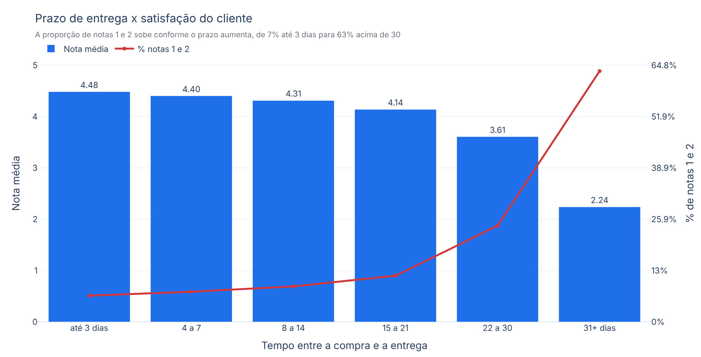
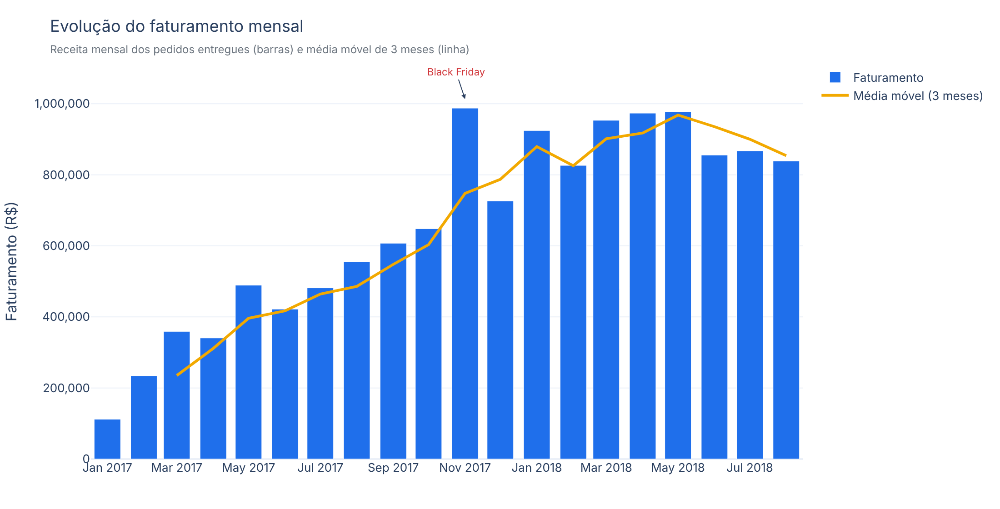
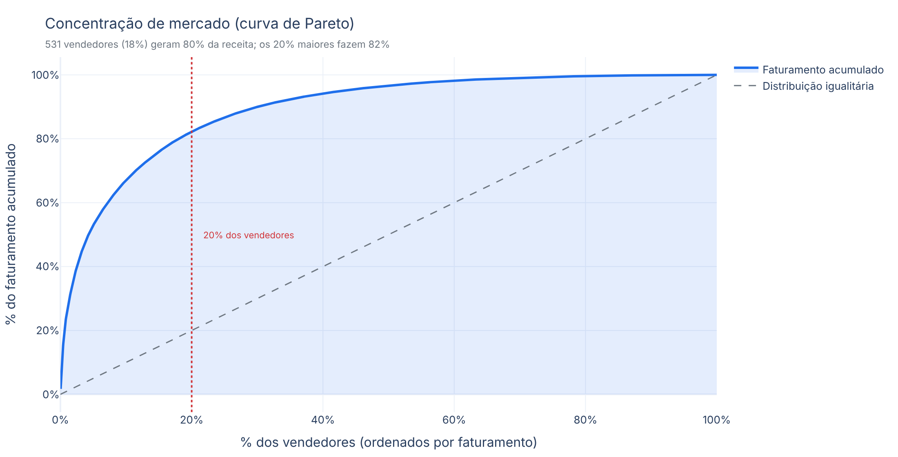
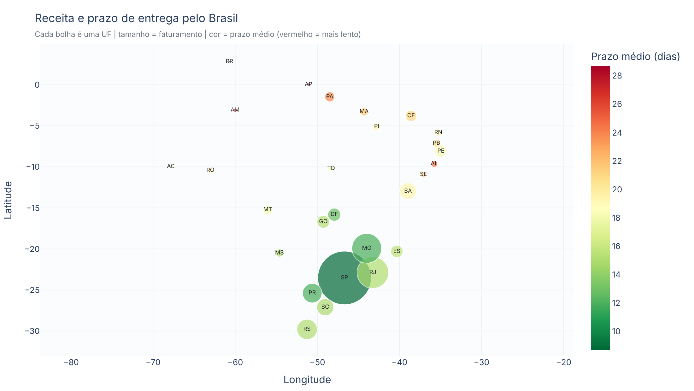
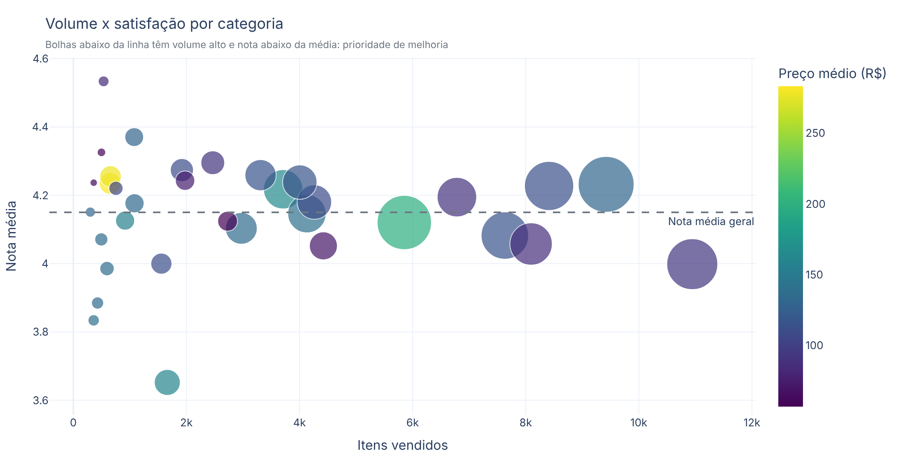

# Olist: análise de performance de vendas

Análise exploratória e dashboard interativo sobre 96 mil pedidos entregues do
marketplace brasileiro Olist, feitos com Python, Pandas, Plotly e Streamlit.

[](https://github.com/sergiomeyer23/olist-sales-performance-analysis/actions/workflows/ci.yml)

> A pergunta central do projeto: onde estão as alavancas de crescimento e de
> satisfação de um marketplace com R$ 13,2 milhões em vendas?

## Principais descobertas

| # | Descoberta | Número |
|---|-----------|--------|
| 1 | Pedidos atrasados recebem nota muito menor | Nota 4,29 no prazo, 2,57 atrasado |
| 2 | Pareto entre vendedores: os 10 maiores fazem 13,3% da receita e 531 vendedores fazem 80% | 18% dos vendedores geram 80% da receita |
| 3 | Concentração geográfica no Sudeste | SP, RJ e MG = 63% da receita |
| 4 | Vender longe custa caro: frete e prazo penalizam o Norte e o Nordeste | Frete = 22,7% do preço no Norte, contra 13,1% no Sudeste (mesmo estado) |
| 5 | O parcelamento sustenta o ticket | R$ 101 à vista, R$ 333 em 7 a 10x |

Só 8,1% dos pedidos atrasam, mas 46% deles recebem nota 1. Se os pedidos
atrasados tivessem a nota média dos entregues no prazo, a nota geral subiria de
4,16 para 4,29. A correlação não prova causa, mas o tamanho da diferença justifica
tratar o prazo como prioridade.

## Dashboard interativo

```bash
streamlit run app.py
```

O dashboard tem seis abas e filtros globais por período, região, categoria e
faixa de preço:

| Aba | O que responde |
|-----|----------------|
| Visão geral | A receita cresce? Quando o cliente compra? |
| Produtos | Quais categorias sustentam a receita e quais decepcionam? |
| Vendedores | O mercado é concentrado? Quem vende muito e avalia mal? |
| Geografia | Onde está o dinheiro e onde a entrega falha? |
| Entrega & Satisfação | Qual o impacto real do prazo na nota? Como o cliente paga? |
| Dados | Metodologia, amostra da base e download em CSV |

## Alguns dos gráficos

### Prazo de entrega x satisfação


A nota cai a cada faixa de prazo. Acima de 30 dias, 63% das avaliações são 1 ou 2.

### Evolução do faturamento


O faturamento cresceu forte em 2017 e ficou em torno de R$ 900 mil por mês em
2018 (média de R$ 902 mil de janeiro a agosto). O pico de nov/2017 (R$ 988 mil) é
a Black Friday. Em dezembro o faturamento cai, provavelmente porque o cliente
antecipa a compra de Natal sabendo que a entrega demora.

### Concentração de mercado (Pareto)


Os 10 maiores vendedores fazem 13,3% da receita, mas 531 vendedores (18% dos
2.945 ativos) geram 80% do faturamento. Os 20% maiores respondem por 82%.

### Receita e prazo pelo Brasil


Tamanho = faturamento, cor = prazo médio. Quanto mais ao norte, mais lenta a
entrega e menor a receita. (No dashboard este mapa é interativo, com tiles reais.)

### Volume x satisfação por categoria


As categorias abaixo da linha vendem muito e têm nota baixa, então são prioridade
de melhoria. Móveis de escritório (nota 3,65) e cama, mesa e banho (4,00) estão
nesse grupo. São itens volumosos, com frete caro e maior risco de avaria.

> As 17 figuras em PNG e 18 em HTML interativo estão em [`outputs/figuras/`](outputs/figuras)
> e as tabelas de resumo em [`outputs/tabelas/`](outputs/tabelas).

## Como rodar

```bash
# 1. Clonar e entrar no projeto
git clone https://github.com/sergiomeyer23/olist-sales-performance-analysis.git
cd olist-sales-performance-analysis

# 2. Ambiente virtual
python -m venv .venv
source .venv/bin/activate        # Windows: .venv\Scripts\activate

# 3. Dependências
pip install -r requirements.txt

# 4. Dashboard interativo
streamlit run app.py

# 5. (Opcional) Gerar todas as figuras e tabelas estáticas
python gerar_relatorio.py

# 6. (Opcional) Rodar os testes
pytest -q                        # 22 testes: métricas + dashboard
```

Os CSVs já estão em `dados/`. A fonte original é o
[Brazilian E-Commerce Public Dataset by Olist](https://www.kaggle.com/datasets/olistbr/brazilian-ecommerce) (Kaggle).

## Estrutura do projeto

```
olist-sales-performance-analysis/
├── app.py                      # Dashboard Streamlit (6 abas, filtros globais)
├── gerar_relatorio.py          # Exporta 17 figuras + 6 tabelas para outputs/
├── requirements.txt
├── src/
│   ├── config.py               # Caminhos, regras de negócio, paleta e labels
│   ├── data_loader.py          # Limpeza dos 9 CSVs → tabela analítica (cache Parquet)
│   ├── analysis.py             # 20 funções de análise (só cálculo, sem gráfico)
│   └── plots.py                # 18 funções de gráfico (só desenho, sem cálculo)
├── notebooks/
│   └── 01_analise_exploratoria.py   # A investigação narrada, passo a passo
├── tests/
│   ├── test_analysis.py        # 16 testes de sanidade das métricas
│   └── test_app.py             # 6 testes do dashboard (AppTest do Streamlit)
├── dados/                      # CSVs brutos do Kaggle
└── outputs/
    ├── figuras/                # PNG (README) + HTML (interativo)
    └── tabelas/                # Resumos em CSV
```

`analysis.py` só calcula e `plots.py` só desenha. Assim o mesmo número alimenta o
dashboard, o relatório estático e os testes, e nenhuma métrica é calculada de duas
formas em lugares diferentes.

### Testes

```bash
pytest -q     # 22 passed
```

- `test_analysis.py` cobre o que não pode quebrar: os joins não duplicam itens, o
  faturamento mensal bate com o total, a curva de Pareto é monotônica e termina em
  100%, e o insight central (atraso derruba a nota em mais de 1 estrela) continua
  valendo.
- `test_app.py` executa o dashboard de verdade com o `AppTest` do Streamlit. Foi ele
  que pegou um `IndexError` real: com filtros muito restritivos (ex.: Norte +
  Livros) o recorte podia não ter nenhum pedido atrasado, e a comparação "no prazo x
  atrasado" quebrava o app.

## Tratamento dos dados

Decisões tomadas na limpeza (documentadas em `src/data_loader.py`):

| Decisão | Motivo |
|---------|--------|
| Só pedidos com status `delivered` | Cancelados e indisponíveis inflariam o faturamento sem receita real |
| Recorte de jan/2017 a ago/2018 | Os meses das pontas têm 1 a 4 pedidos e distorcem qualquer série temporal |
| Uma avaliação por pedido (a mais recente) | 551 pedidos têm avaliação duplicada; sem tratar, o join multiplicaria as linhas. As médias de nota são calculadas no grão de pedido, não de item |
| Um meio de pagamento por pedido (o de maior valor) | Pedidos com voucher + cartão apareceriam duas vezes |
| Produtos sem categoria → `uncategorized` | ~1,6k produtos; descartá-los tiraria receita real da análise |
| Frete separado do faturamento | Faturamento = preço dos produtos; frete é analisado como custo logístico |

Granularidade final: uma linha = um item vendido e entregue (109.872 linhas).

## Recomendações de negócio

1. Reduzir o atraso. Os 8,1% de pedidos atrasados perdem 1,73 estrela cada. Com
   a nota dos pedidos no prazo, a nota geral iria de 4,16 para 4,29. No marketplace
   o atraso nasce em duas etapas, a postagem pelo seller (`order_delivered_carrier_date`)
   e o transporte até o cliente. Vale acompanhar o SLA de postagem por seller.
2. Gerir vendedores em dois grupos. Conta dedicada para os ~530 que fazem 80% da
   receita; autoatendimento e automação para a cauda longa.
3. Prospectar sellers no Norte e no Nordeste. Só 1,8% dos vendedores ativos estão
   no Nordeste e 0,1% no Norte, e as duas regiões têm prazo de 20 a 23 dias, frete
   de 22% a 23% do preço nas vendas interestaduais e nota de 3,97 no Nordeste, a
   menor do país. Sellers locais encurtam o trajeto, e a malha logística com
   cross-docking regional reduz o prazo dos que continuam no Sudeste.
4. Revisar as categorias volumosas. Móveis de escritório e cama, mesa e banho têm
   volume alto e nota abaixo da média: embalagem melhor e prazo realista no anúncio.
5. Preparar a operação para novembro. Em nov/2017 a taxa de atraso foi de 14%,
   contra 5% em outubro, e a nota média caiu de 4,21 para 3,99.

## Limitações

- A análise cobre apenas pedidos entregues entre jan/2017 e ago/2018. Cancelados,
  indisponíveis e o período de cauda curta ficaram de fora para não distorcer a
  receita e a série temporal.
- Os dados são observacionais: atraso correlaciona com nota baixa, mas isso não
  prova causalidade. O recorte também não controla preço, produto ou região ao
  mesmo tempo.
- As médias de nota são calculadas no grão de pedido. Um pedido com vários itens
  conta uma vez; um pedido com itens de categorias diferentes conta em cada
  categoria.
- Filtros muito restritivos no dashboard podem reduzir a amostra a poucas dezenas
  de pedidos. Nesses casos, leia o gráfico como exploratório, não como conclusão.
- O dataset original é anonimizado e público, e este repositório não tem dados
  pessoais reais.

## Licença e dados

- Código: [MIT](LICENSE).
- Dataset: [Brazilian E-Commerce Public Dataset by Olist](https://www.kaggle.com/datasets/olistbr/brazilian-ecommerce)
  (Kaggle), licença CC BY-NC-SA 4.0. Os CSVs em `dados/` ficam no repositório para
  reprodutibilidade; as figuras e tabelas em `outputs/` foram geradas a partir deles.

## Tecnologias

`Python 3.11+` · `Pandas` · `NumPy` · `Plotly` · `Streamlit` · `PyArrow` · `Pytest`
